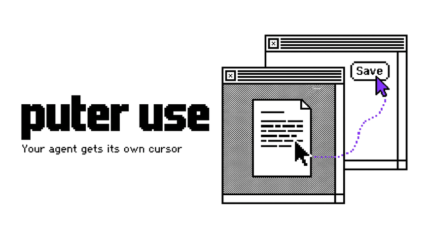

[](https://github.com/NathanMartinNZ/puter-use/releases)
[](https://github.com/NathanMartinNZ/puter-use/actions/workflows/tests.yml)
[](LICENSE)
[](#requirements)
[](https://modelcontextprotocol.io)

Background computer use for macOS. Your AI agent (Claude Code, Codex, Cursor, …) operates your real
Mac apps, such as your logged-in Firefox, Notes or Finder, with **its own cursor and keyboard**. Your
mouse and keyboard stay yours, so you keep working while it does. It works like OpenAI's Codex
Computer Use, for any agent that speaks MCP.

- **Works in the background.** Events go straight to the target window. Your real pointer never
  moves and the app you're using stays in front. A purple cursor shows where the agent is acting.
- **Light on context.** Only the target window is captured, even when it's covered, at about
  350–800 image tokens. After an action, a new screenshot is sent only if the window changed.
- **Hard to misclick.** The agent can aim by what a control says (`target: "Save"`) instead of by
  pixels, and a batch stops if something opens over the window part-way through.
- **Fewer model calls.** One call runs many steps: clicks, typing, shortcuts, menu commands, a whole
  form. A batch that worked can be saved as a macro and replayed in one step.
- **Guard rails.** Password managers are off limits, terminals are clicks-only, nothing is typed into
  password fields, and Delete, Send, Pay and the like wait for your OK.
- **Several agents at once**, each with its own pointer in its own colour.

## Requirements

- macOS 14 or later
- Xcode Command Line Tools (`xcode-select --install`), to build the helper app
- [uv](https://docs.astral.sh/uv/getting-started/installation/), which also installs Python 3.13
- An agent that supports MCP, or a shell for the [CLI](docs/cli.md)

## Quick start

### 1. Install

```bash
git clone https://github.com/NathanMartinNZ/puter-use.git
cd puter-use
./scripts/build-helper.sh   # builds build/PuterUse.app
uv sync
uv run puter-use setup      # asks macOS for the permissions it needs
```

macOS ties permissions to the app's code signature, so the build script signs `PuterUse.app` with a
self-signed identity that stays the same across rebuilds. It's kept in a private keychain file under
`~/Library/Application Support/puter-use/signing`, isn't added to your keychain list, and changes no
trust settings. Set `PUTER_USE_SIGN_IDENTITY` to sign with your own identity instead.

### 2. Grant permissions

In **System Settings → Privacy & Security**, turn on **PuterUse** under both:

- **Accessibility**
- **Screen & System Audio Recording**

Then check it's ready. It should print `ready`:

```bash
uv run puter-use quit && uv run puter-use setup
```

### 3. Connect your agent

Run these from the `puter-use` folder, so that `$(pwd)` is where you cloned it.

**Claude Code**

```bash
claude mcp add --scope user puter-use -- uv run --directory "$(pwd)" puter-use mcp
```

**Codex**: add this to `~/.codex/config.toml`, with `/path/to/puter-use` replaced by the output of `pwd`:

```toml
[mcp_servers.puter-use]
command = "uv"
args = ["run", "--directory", "/path/to/puter-use", "puter-use", "mcp"]
```

**Cursor**: add this to `~/.cursor/mcp.json`, with the same replacement:

```json
{
  "mcpServers": {
    "puter-use": {
      "command": "uv",
      "args": ["run", "--directory", "/path/to/puter-use", "puter-use", "mcp"]
    }
  }
}
```

**Other agents**: any MCP client can run `uv run --directory /path/to/puter-use puter-use mcp` over
stdio. For agents that use skills instead of MCP, copy or symlink `skills/puter-use` into the agent's
skills folder (e.g. `~/.claude/skills/`). The skill drives the CLI.

### 4. Try it

Restart your agent, then ask it something like:

> Use puter-use to open Calculator and work out 1234 × 5678.

> Use puter-use to open TextEdit and write a short poem in a new document.

A purple cursor works in that app's window while you carry on in yours.

## Using it without an agent

The CLI drives apps the same way, from your shell or a script:

```bash
uv run puter-use windows Firefox            # list Firefox's windows
uv run puter-use shot Firefox               # screenshot one; prints a status line and the image's path
uv run puter-use click -e Save              # click the element showing "Save"
uv run puter-use type "hello" --submit      # type into the focused field, then press Return
uv run puter-use menu "File > Export as PDF…"
uv run puter-use release                    # hide the agent cursor
```

See [docs/cli.md](docs/cli.md) for every command, and [Code mode](docs/tools.md#code-mode) for
Python scripts with loops and branches.

## Safety

puter-use operates apps where you're logged in, so these are on by default:

| | |
|---|---|
| **off limits** | password managers (1Password, Bitwarden, Keychain Access, Passwords, …): not listed or captured |
| **clicks only** | terminals (Terminal, iTerm2, Warp, Ghostty, …): no typing, keys or pasting |
| **asks first** | pressing anything labelled delete, send, pay, buy, publish, transfer, … |
| **won't type** | into password fields |

You can change them per app in `~/Library/Application Support/puter-use/policy.json`. See
[docs/policy.md](docs/policy.md).

These are a safety net, not a guarantee. What an agent reads on screen (web pages, mail, documents)
can carry instructions aimed at it. The tool descriptions tell agents to treat screen text as data,
but a model can still be misled: keep an eye on agents browsing untrusted sites while logged in, and
don't connect agents you don't trust.

## Configuration

Settings are environment variables, set in the `env` of your agent's MCP server config. The ones
you're most likely to want:

| variable | default | meaning |
|---|---|---|
| `PUTER_USE_WINDOW_SIZE` | `off` | e.g. `1280x860`: windows the agent opens are shrunk to fit, so screenshots stay sharp |
| `PUTER_USE_CURSOR_SPEED` | `1` | pointer pace: `2` = twice as fast, `0` = jump instantly |
| `PUTER_USE_TYPING_WPM` | `140` | typing speed; `0` = as fast as possible |
| `PUTER_USE_CURSOR` | `1` | `0` hides the agent cursor |
| `PUTER_USE_TILE` | `28` | image tile size: 28 for Claude, 32 for OpenAI models |

All settings: [docs/configuration.md](docs/configuration.md).

## Troubleshooting

- **`setup` prints `NOT granted`.** Turn PuterUse on in both panes (step 2), then run
  `uv run puter-use quit && uv run puter-use setup`.
- **`PuterUse.app not found`.** Run `./scripts/build-helper.sh` first, or set `PUTER_USE_APP` to the
  app's path.
- **Permissions are lost after a rebuild.** Build with `./scripts/build-helper.sh`, which keeps the
  signature the same. An ad-hoc build (`PUTER_USE_SIGN_IDENTITY=-`) loses them every time.
- **Your agent doesn't show the tools.** Restart it after adding the server. In Claude Code,
  `claude mcp list` shows whether puter-use connected.
- **An app ignores clicks or typing.** Canvas, GPU and game apps and some Electron or Java apps only
  listen to the real pointer. Use `foreground=true` (`--fg` in the CLI): it brings the app forward and
  uses your real cursor and keyboard, so it interrupts you.
- **Hover menus don't open.** Most apps work out hover from the real pointer. Click instead.

## How it works

```
agent ──MCP (stdio)──▶ puter-use (Python) ──JSON over Unix socket──▶ PuterUse.app (Swift, menu-bar-less)
         or CLI                                                        ├─ ScreenCaptureKit per-window capture
                                                                       ├─ Accessibility tree + AX actions
                                                                       ├─ CGEvent.postToPid + window stamping
                                                                       └─ agent pointer: human-like path, drawn + sent
```

`PuterUse.app` holds the macOS permissions, so they work the same whichever agent launches the MCP
server or CLI. It starts on demand. Input goes to one app's process through private WindowServer
(SkyLight) calls, and the agent's pointer moves and types like a person.

## Limitations

- **Coverage.**
  - Most AppKit, SwiftUI and Gecko apps work in the background.
  - Canvas, GPU and game apps (Blender, Unity, games) and some Electron or Java apps read the hardware
    pointer or drop per-process events. For those, use `foreground=true` (`--fg`). It raises the app
    and uses the real cursor and keyboard.
- **Hover.** Apps work out hover from the real pointer (AppKit tracking areas, Firefox), so a
  background `move` reaches the app as mouse-moved events but doesn't light up hover effects or open
  hover menus. Click instead, or use `foreground=true`.
- **Characters off the keyboard layout** (é, €, emoji) are typed as text on a stand-in key (é on the e
  key). Apps that read key codes rather than text (some games, remote desktops) see the stand-in.
- **Drag.** Text selection (see [Selecting text in the background](docs/how-it-works.md#human-input))
  and in-window drags work. Drags into another app (WindowServer drag-and-drop) don't.
- **Open and Save panels** run in a separate macOS process, so keys sent to the app (Escape, Return)
  may not reach them. Press their buttons by element (`click` with `element`) instead.
- **Scroll distance** is approximate (±20%). Scroll, then look.
- **Captures.** A minimized window can't be captured until restored. Windows on another Space are
  captured from their backing store.
- **Shortcuts in Chromium/Electron** must exist in the app's menus to work in the background.
- **Security.**
  - Any process running as you can use the helper socket (`0600`, in your Library).
  - Don't connect untrusted agents to it. [Policy](docs/policy.md) keeps agents out of password
    managers and away from password fields, and asks before irreversible presses, but it's a safety net.
  - The private SkyLight APIs can change with macOS updates.

## Documentation

| | |
|---|---|
| [Features](docs/features.md) | everything puter-use does, in detail |
| [Tools](docs/tools.md) | the MCP tools, every action, naming elements, macros, code mode, sessions |
| [CLI](docs/cli.md) | every command, with examples |
| [Policy](docs/policy.md) | what agents may do in each app, and what needs your OK |
| [Configuration](docs/configuration.md) | all environment variables |
| [How it works](docs/how-it-works.md) | background input, human-like pointer and typing, testing it |
| [Image size](docs/image-size.md) | how screenshots are sized for tokens |

## Development

```bash
uv sync
uv run pytest
```

`scripts/probe.sh` starts a test window that logs every event it receives, and
`scripts/check_motion.py` checks the agent's input against it. See
[Checking it](docs/how-it-works.md#human-input).

Issues and pull requests are welcome. For a larger change, open an issue first to talk it through.

## Acknowledgements

The background input techniques build on reverse-engineering work by open-codex-computer-use and
cua-driver.

## License

[MIT](LICENSE)
